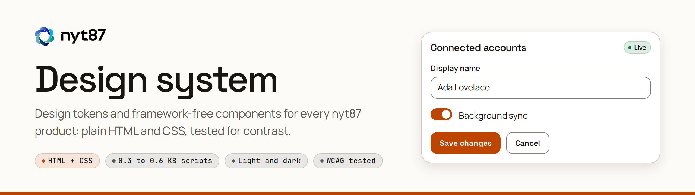

<p align="center">
  <picture>
    <source media="(prefers-color-scheme: dark)" srcset=".github/banner/banner-dark.png">
    
  </picture>
</p>

<p align="center">
  <a href="https://nyt87.github.io/design-system/">Component guide</a> ·
  <a href="https://github.com/orgs/NYT87/packages?repo_name=design-system">Packages</a> ·
  <a href="DESIGN.md">Design language</a>
</p>

# nyt87 design system

| Package | What |
|---|---|
| `packages/tokens` (`@nyt87/tokens`) | Design tokens as CSS variables, with a WCAG contrast test. Source: `src/tokens.mjs`. |
| `packages/ui` (`@nyt87/ui`) | Framework-free components: HTML and CSS (`ds-*` classes), plus tiny vanilla scripts (0.3 to 0.6 KB gzipped each) only for tabs, modal, header menu, copy button, file drop and theme scope. No React, no dependencies beyond the tokens. |
| `apps/docs` | The public component guide: live examples, code, usage rules, a11y notes, props. |

Language and rules: [DESIGN.md](DESIGN.md).

```
npm install
npm run dev        # build tokens, start the docs site
npm test           # contrast tests + component tests
npm run typecheck
npm run build      # static site in apps/docs/dist
```

## Publishing the guide
`.github/workflows/pages.yml` tests, builds and deploys `apps/docs/dist` to GitHub Pages on every push to `main` (pull requests only build and test). One-time setup: in the repo go to Settings > Pages and set Source to **GitHub Actions**. The site is then at `https://<owner>.github.io/<repo>/`. The build uses relative asset paths and hash routing, so it works under that sub-path with no config.

## Releasing the packages
Releases are automated with [Release Please](https://github.com/googleapis/release-please), and each package is versioned on its own.

1. Merge changes to `main` using **Conventional Commits**. The commit type decides the next version (while below 1.0):

   | Commit | Release |
   |---|---|
   | `fix(ui): ...`, `fix(tokens): ...` | patch (0.1.0 to 0.1.1) |
   | `feat(ui): ...`, `feat(tokens): ...` | minor (0.1.1 to 0.2.0) |
   | `feat(ui)!: ...` or a `BREAKING CHANGE:` footer | minor while 0.x, major from 1.0 |
   | `docs:`, `chore:`, `ci:`, `test:`, `refactor:` | no release |

   Release Please looks at which folder a commit changed (`packages/tokens` or `packages/ui`), so the scope is for readers.
2. Release Please opens (and keeps updating) one **release PR** with the version bumps and changelogs. CI is run on it automatically.
3. **Merge the release PR** when you want to ship. That creates the tags (`tokens-vX.Y.Z`, `ui-vX.Y.Z`) and GitHub releases, and the same workflow then publishes exactly the packages that were released to GitHub Packages.

`@nyt87/ui` accepts any `@nyt87/tokens` 0.x (`>=0.1.0 <1.0.0`). When a tokens change would break the UI package, raise that range in the same PR.

To publish a version that is in `package.json` but not on the registry (a retry, or the first release), run **Actions > Release > Run workflow**. Versions already published are skipped.

Workflows: `ci.yml` (checks on every PR), `release.yml` (release PR and publish), `pages.yml` (docs site on every push to `main`).

## Using the packages in a project
GitHub Packages needs a token to install, even for public packages.

1. Add `.npmrc` to the project (safe to commit, it holds no secret):
```
@nyt87:registry=https://npm.pkg.github.com
//npm.pkg.github.com/:_authToken=${NODE_AUTH_TOKEN}
```
2. Locally: `gh auth refresh -s read:packages`, then `export NODE_AUTH_TOKEN=$(gh auth token)` (put it in your shell profile).
3. In GitHub Actions of the consuming repo: give the job `permissions: { contents: read, packages: read }` and set `NODE_AUTH_TOKEN: ${{ secrets.GITHUB_TOKEN }}` on the install step. In the package's settings on GitHub (Package settings > Manage Actions access), add each consuming repository so its `GITHUB_TOKEN` may read it.
4. `npm i @nyt87/tokens @nyt87/ui`, import the two stylesheets once, write the HTML from a component page, and import only the behaviours the page needs (`@nyt87/ui/menu`, `/tabs`, `/modal`, `/copy`, `/drop`, `/theme-scope`). See the docs site, Getting started.

## Adding a component
1. Styles in `packages/ui/src/styles.css` (tokens only, `ds-` prefix). Use native elements first; add a behaviour in `packages/ui/src/behaviors/` only when the platform has no answer, as a small delegated-event module with its own entry in `tsup.config.ts` and `package.json` exports.
2. A test in `packages/ui/test` for any behaviour.
3. `apps/docs/src/examples/name.html` (shown live and as its own code) and an entry in `apps/docs/src/content.ts`. The docs tests check every example for unique ids, resolving references, named controls and alt text.

## Adopting in a product
See `packages/tokens/README.md` for the variable rename map. Replace local duplicates (modals, empty states, error panels, stat grids) with `@nyt87/ui` one at a time.
